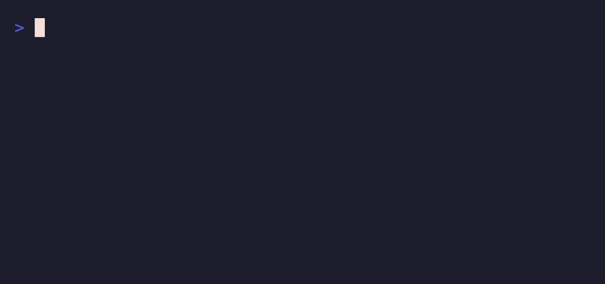

<h1 align="center">red-handed</h1>

<p align="center">
  <em>에이전트가 "테스트 통과"라고 말했다. 진짜로 돌았는지 이게 확인해준다.</em>
</p>

<p align="center">
  <a href="https://www.npmjs.com/package/@jinhyuk9714/red-handed"></a>
  <a href="https://github.com/sjh9714/red-handed/actions/workflows/ci.yml"></a>
  
  
</p>

<p align="center">
  <sub><a href="README.md">English</a></sub>
</p>

<p align="center">
  
</p>

명령 하나면 됩니다.

```bash
npx @jinhyuk9714/red-handed@latest
```

제 컴퓨터에서는 세션 526개를 읽었고, 에이전트가 "테스트 통과"라고 183번 말했는데
그중 9번은 읽을 수 있는 실행이 없었습니다. **당신 것은 몇 번인가요?**

이미 디스크에 있는 Claude Code 세션 기록과 git 상태만 읽습니다. 계정도 API 키도
모델 호출도 없고, 아무것도 컴퓨터 밖으로 나가지 않습니다.
(`npx`는 다른 패키지와 마찬가지로 npm 레지스트리에서 패키지를 받아옵니다.)

## 버려진 실행 결과

실행이 사라지는 더 조용한 경로가 하나 더 있습니다. 에이전트는 컨텍스트를 아끼려고
테스트 출력을 잘라냅니다.

```bash
npx vitest run 2>&1 | tail -5
```

`tail -5`는 마지막 다섯 줄만 남기는데, `Tests 33 passed` 같은 요약 줄이 그 위에 있는
경우가 많습니다. 테스트는 돌았습니다. 기록에는 안 남았을 뿐입니다. 제 컴퓨터에서는
테스트 실행의 49%가 이렇게 끝났습니다. `red-handed receipts`가 당신 것을 세줍니다.

이건 명령 하나로 막을 수 있습니다.

```bash
npx @jinhyuk9714/red-handed@latest fix
```

작은 훅이 설치됩니다. 에이전트가 결과를 잘라내는 파이프가 붙은 테스트 명령을 치려는
순간, 그 파이프만 떼서 결과가 기록에 남게 합니다. 테스트 출력은 중앙값이 몇백 글자라
안 잘라도 손해가 거의 없습니다. 권한은 절대 건드리지 않고, 테스트 명령의 명령어만
고칩니다. `unfix`로 제거합니다.

## 감사도 합니다

숫자 뒤에 원래 도구가 있습니다. 세션 기록을 git 상태와 나란히 놓고,
에이전트가 *한 말*과 실제로 *한 일*이 어긋나는 지점을 타임스탬프와 인용문으로 보여주는 검사 아홉 개.

글로 정리했을 때 세션이 249개였습니다. 확정 판정은 0건이었고, 무엇으로도 읽을 수
없는 확인 7건이 걸렸습니다. [전체 이야기](https://sjh9714.tistory.com/9).

## 플러그인으로 설치

두 줄이면 끝이고, 그 뒤로는 외울 것이 없습니다.

```bash
claude plugin marketplace add sjh9714/red-handed
claude plugin install red-handed@red-handed
```

설치하면 훅 두 개가 켜집니다. 하나는 테스트 명령이 실행되기 직전에 결과를 잘라내는
파이프를 떼주고, 하나는 세션이 끝나는 순간 git과 대조해서 걸린 것이 있을 때만
알려줍니다. "테스트 통과했다"는 말이 사실인지 직접 물어볼 수 있는
`/red-handed:audit`와 `/red-handed:history`도 같이 들어옵니다.
플러그인을 지우면 훅 두 개도 같이 꺼집니다.

플러그인을 안 쓴다면 `npx @jinhyuk9714/red-handed@latest fix`와 `install-hook`으로
같은 훅 두 개를 직접 설정할 수 있습니다.

Codex, Cursor, Gemini CLI 같은 다른 에이전트에서는
[skills CLI](https://github.com/vercel-labs/skills)로 같은 스킬을 설치할 수 있습니다.

```bash
npx skills add sjh9714/red-handed
```

## 검사 아홉 가지

| 무엇을 잡나 | id |
| --- | --- |
| 테스트 개수가 줄었음 — 돌지 않는 테스트는 실패할 수도 없음 | `test-census` |
| 실패했는데 통과했다고 말함 | `claim-vs-fail` |
| 돌리지도 않고 통과했다고 말함 — 서브에이전트까지 확인 | `claim-no-run` |
| 오답을 정답으로 바꿔치기 — 코드는 그대로 두고 | `hardcoded-expected` |
| 단언을 실패할 수 없는 것으로 바꾸거나 주석 처리함 | `assertion-weakening` |
| 테스트를 꺼버림 (`.skip`, `.only`, `xit`, `@pytest.mark.skip`) | `skip-only` |
| 훅이 커밋을 막자 훅을 끄고 다시 커밋함 | `no-verify` |
| 검사를 꺼버림 (`strict` 해제, CI 테스트 단계 삭제, 실패한 줄에 억제 주석) | `config-disable` |
| 방금 난 에러를 아무것도 안 하는 catch로 감쌈 | `error-swallowing` |

모든 결과에는 타임스탬프와 인용된 원문이 붙습니다. 직접 세션 기록을 열어보고
반박할 수 있습니다.

모델을 호출하지 않습니다. 전부 결정론적이라 같은 세션은 항상 같은 답을 냅니다.
주장 문장은 영어·한국어·일본어·중국어로 인식하고, 리포트는 한국어와 영어로 나옵니다.

## 무엇을 못 하나

코드가 맞는지는 판단하지 못합니다. 에이전트 자신의 기록이 에이전트의 말을 뒷받침하지 않는 지점을 알려줄 뿐이고, 그건 훨씬 작은 주장입니다.

알려진 사각지대를 먼저 밝힙니다.

- 주장 문장은 영어·한국어·일본어·중국어를 인식합니다. 리포트 자체는 한국어와 영어로만 나옵니다 — 일본어·중국어 세션은 제대로 읽지만 리포트는 영어로 나오는데, 아무도 검수하지 않은 번역은 없느니만 못하기 때문입니다. 목록에 없는 언어의 세션은 결과가 적게 나올 뿐 틀리게 나오지는 않습니다. 패턴은 데이터 파일(`src/claims/patterns.ts`)이라 추가하기 쉽습니다.
- 읽지 못한 검증은 보지 못한 검증으로 취급합니다. 출력 형식을 해석하지 못하는 자체 스크립트로 테스트를 돌렸다면, 진짜 주장이라도 "검거"가 아니라 "의심"으로 낮춥니다.
- 브라우저 테스트나 수동 확인처럼 기계가 읽을 결과가 없는 검증은 보이지 않습니다.
- `--git-only` 모드에는 읽을 세션 기록이 없어서, 거기서 나오는 것은 전부 의심 이상이 될 수 없습니다.

## 검거와 의심

`검거`는 두 가지가 동시에 참일 때만 붙습니다. 세션에 에이전트가 그렇게 한 기록이 있고, 지금 코드에도 그대로 남아 있을 것. 나중에 에이전트가 되돌렸다면 추궁할 것이 없으므로 결과에서 사라집니다.

`의심`은 패턴은 있지만 의도가 확정되지 않았다는 뜻입니다. 빈 catch가 옳은 경우도 있고, 일부러 끈 테스트가 옳은 경우도 있습니다.

이 도구는 잘못 고발하기보다 놓치는 쪽으로 맞춰져 있고, 그 대가가 무엇인지도
밝혀둡니다. 이 코드를 적대적으로 검토한 결과, 정직한 작업에 `검거`를 찍는 경로가
다섯 개 발견됐습니다 — 타임아웃된 테스트를 실패로 읽음, 모르는 러너(`rspec`,
`phpunit`, `tox`)를 "안 돌렸다"로 읽음, 다른 런처로 다시 돌린 것을 보지 못함,
의도된 동작 변경을 정답 바꿔치기로 읽음, 백그라운드 명령을 통과로 셈함. 다섯 개
모두 고쳤고 각각 `test/regression/false-accusations.test.ts`에 영구 회귀 테스트가
있습니다. 여섯 번째를 찾으신다면 그게 제가 가장 받고 싶은 버그 리포트입니다.

여섯 번째 오탐은 제 기록 전체에 돌려보다가 나왔습니다. 범위를 좁힌 `pytest tests/test_sync_cli.py`
뒤에 GitHub 워크플로 파일과 별개 웹 앱의 `.tsx` 두 개가 바뀌었는데, 도구가 그
주장을 "낡았다"고 판정했습니다. 파이썬 테스트는 `.tsx`를 임포트할 수 없고
워크플로는 방금 여기서 돈 것이 아니므로 그 주장은 낡지 않았습니다. 이제
실행기가 실제로 읽을 수 있었던 변경만 셉니다.

## 사용법

```
red-handed                        "테스트 통과" 주장 중 진짜 실행이 있었던 비율
red-handed audit                  이 디렉토리의 최신 세션 감사
red-handed audit --all            이 디렉토리의 모든 세션 감사
red-handed audit --session <id>   특정 세션 감사
red-handed audit --git-only       세션 기록 없이 변경분만 감사
red-handed stats                  이 컴퓨터의 모든 근거 없는 주장, 인용문과 함께
red-handed fix                    테스트 출력을 잘라내는 파이프를 실행 전에 떼기
red-handed unfix                  그거 되돌리기
red-handed receipts               결과가 버려진 테스트 실행 세기
red-handed demo                   지어낸 세션으로 모든 검사 보기
red-handed install-hook           세션이 끝날 때마다 자동 감사
```

`install-hook`을 한 번 실행해두면 이후에는 아무것도 기억할 필요가 없습니다.
세션이 끝날 때마다 0.1초 만에 자동으로 감사하고, 깨끗하면 아무것도 보이지
않으며, 검거된 것이 있을 때만 Claude Code 화면에 경고 한 줄이 뜹니다:

> red-handed: 이번 세션에서 검거 1건 — `npx red-handed`로 확인하세요

어떤 경우에도 세션을 막지 않습니다. 기존 훅은 건드리지 않고, 이전 설정은
`settings.json.red-handed-backup`으로 백업합니다.

주요 옵션: `--json` / `--md` 기계 판독용 출력, `--lang ko` 한국어, `--fail-on caught|suspicious|never` CI용, `--detectors a,b` 일부만 실행.
리포트 언어는 시스템 로케일을 따라가므로 한국어 macOS에서는 `--lang ko` 없이도 한국어로 나옵니다.

종료 코드: `0` 없음, `1` `--fail-on` 기준 이상 발견, `2` 잘못된 사용.

## 요구사항

Node 20 이상. 세션 로그는 `~/.claude/projects`에서 읽습니다. 테스트 출력 파싱은
vitest, jest, mocha, pytest, rspec, minitest, phpunit, 파이썬 unittest,
`go test`, `cargo test`, `node --test`를 지원합니다. tox·ctest와 `make test`,
`./gradlew test`, `bundle exec`, 테스트처럼 이름 붙은 프로젝트 스크립트도 실행
자체는 인식합니다. 출력을 아직 못 읽는 러너라도 그에 대한 주장을 "검거"로
넘기지 않는다는 뜻입니다.

## 어떻게 만들었나

Claude Code로 작성했습니다. 스펙과 오탐 규칙은 제가 썼고 탐지기를 전부 리뷰한 뒤,
완성된 물건을 적대적 검토에 넘겼습니다. 그 검토는 모든 결함을 빌드된 바이너리에서
직접 재현한 뒤에야 주장했습니다.

지금의 가드 대부분이 거기서 나왔습니다. 그리고 그 검토는 이 도구가 바로 자기가
잡으라고 만들어진 짓을 하고 있었다는 것도 잡아냈습니다. README에 적어뒀던 "검거
0건" 릴리스 게이트는 제 세션이 전부 JS/TS라서 타임아웃을 실패로 잘못 읽는 코드
경로가 한 번도 실행되지 않았기 때문에 통과한 것이었습니다. 운으로 통과하고 성공을
보고한 겁니다. 이 도구가 요약이 아니라 증거를 보려고 하는 이유가 그것입니다.

## 라이선스

MIT
